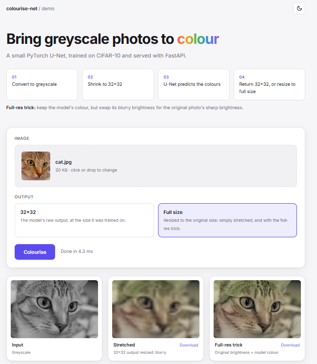
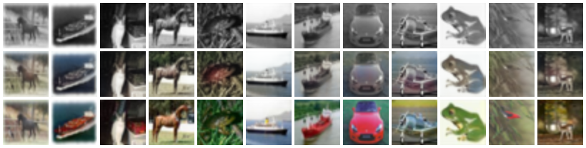
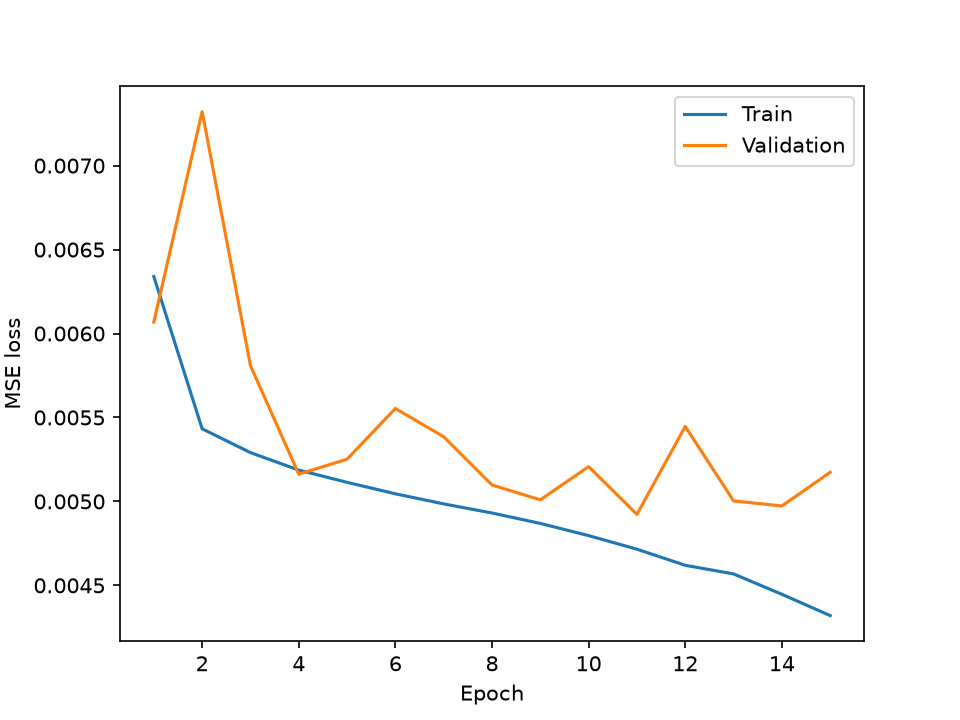
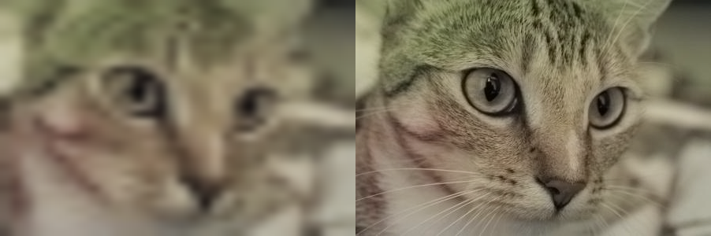

# colourise-net

Turn greyscale images into colour images with a small PyTorch U-Net trained on CIFAR-10, served through a FastAPI inference server with a simple web demo.



*The web demo: upload an image, then compare the stretched model output with the full-res trick.*



*Top: greyscale input. Middle: model output. Bottom: real image. (Images are 32×32, upscaled for display.)*

## Project structure
| File | Purpose |
|---|---|
| `model.py` | U-Net architecture (~1.9M parameters) |
| `train.py` | Trains the model on CIFAR-10, saves the best checkpoint |
| `evaluate.py` | Test-set MSE/PSNR and the comparison image above |
| `serve.py` | FastAPI inference server |
| `test_serve.py` | Automated tests for the server |
| `checkpoints/best_model.pt` | Trained weights (included, so no retraining needed) |
| `static/index.html` | Web demo page |

## How it works

The model tries to learn a function `f(greyscale_image) -> colour_image`.

Each CIFAR-10 photo is converted to greyscale as the input, and the original colour version is the target.

- **Data:** CIFAR-10 (60,000 colour photos, 32×32). Split into 40,000 train / 10,000 validation / 10,000 test.
- **Model:** A U-Net (~1.9M parameters). The encoder shrinks the image to understand what's in it, the decoder grows it back to paint in colours, and skip connections carry sharp details across.
- **Loss:** Mean squared error between predicted and real pixel values.
- **Training:** 15 epochs with the Adam optimizer (learning rate 0.001), saving the model with the best validation loss.



## Inference server

`serve.py` wraps the trained model in an HTTP API using [FastAPI](https://fastapi.tiangolo.com/): send it an image and get a colourised image back.

```text
client (web demo, curl or any app)
  │  POST /colourise (image)
  ▼
greyscale, shrink to 32×32
  │
  ▼
U-Net  ◀── loaded once at startup
  │
  ├── full_res=false ──▶ raw 32×32 output
  │
  └── default ─────────▶ side by side: stretched | full-res trick
  │
  ▼
PNG back to client
```

### Endpoints

| Method | Path | Description |
|---|---|---|
| `GET` | `/` | Web demo: upload an image and compare the results in the browser. |
| `POST` | `/colourise` | Upload an image, get a colourised PNG back. By default returns the stretched model output (left) and the full-res trick (right) side by side. `?full_res=false` returns the raw 32×32 model output. |
| `GET` | `/health` | Server status, device (CPU/GPU) and model parameter count. |
| `GET` | `/docs` | Interactive API docs, generated by FastAPI. |


*Left: model output stretched to full size (blurry). Right: full-res trick, the model's colour with the original photo's sharp brightness.*

### Run it

Tested with Python 3.11.9 on Windows. Other recent Python 3 versions should work but haven't been tested.

```bash
git clone https://github.com/bilalm-19/colourise-net.git
cd colourise-net
python -m venv venv
venv\Scripts\activate            # Mac/Linux: source venv/bin/activate
pip install -r requirements.txt  # PyTorch is a large download, so the first install takes a while
uvicorn serve:app --port 8000
```

**In the browser:** open http://localhost:8000, upload an image, choose 32×32 or full size, and click **Colourise**. (API docs are at http://localhost:8000/docs.)

**From the command line** (replace `path/to/your_image.jpg` with your own image):

Side by side, stretched vs full-res (default):

```bash
curl -F "file=@path/to/your_image.jpg" "http://localhost:8000/colourise" -o colourised.png
```

Raw 32×32 model output:

```bash
curl -F "file=@path/to/your_image.jpg" "http://localhost:8000/colourise?full_res=false" -o colourised_raw.png
```

Check the server is running:

```bash
curl http://localhost:8000/health
```

> On Windows PowerShell, use `curl.exe` instead of `curl`.

### Tests

```bash
pytest
```

The tests use randomly initialised weights, so they check the system independently of the trained checkpoint:

- `/health` reports the model as loaded
- `/colourise` returns the side-by-side image, or the raw 32×32 output with `?full_res=false`
- Files over 5 MB, images over ~16 megapixels and non-images are rejected (413, 415)
- `/` serves the web demo page

### Design decisions

- **Full-res trick.** The model only outputs 32×32, which looks blurry when enlarged. Eyes see detail through brightness rather than colour, so the server keeps the model's colour (Cb, Cr), but swaps its blurry brightness (Y) for the original image's sharp brightness, which is simply its full-size greyscale version.
- **Load once, serve many.** The model is loaded at startup and set to `eval()` mode, so each request only pays for inference.
- **Runs on CPU or GPU.** Trained on an NVIDIA RTX 5060. The server uses a GPU if one is available but runs fine on CPU, since the model is small.
- **Input validation.** Oversized files and non-images are rejected with clear HTTP errors before reaching the model.
- **Web demo as just another client.** The page is plain HTML and JavaScript calling the same `/colourise` endpoint as `curl`, with no separate backend or framework.

### Limitations and areas for improvement
- Colours are not very accurate: often dull, with some wrong tints.
- Trained on 32×32 CIFAR-10, so it works best on its 10 classes (animals and vehicles).
- Could be containerised with Docker, and could batch requests to handle more traffic.